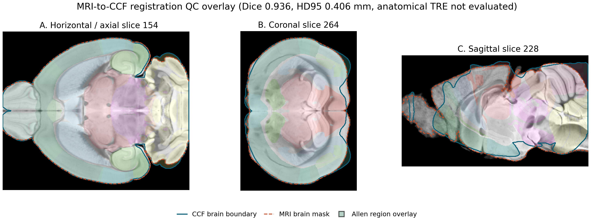

# MRI-to-CCF Registration QC - 2026-07-08

- Status: INCOMPLETE ANATOMICAL TRE.
- Numeric gate: INCOMPLETE_ANATOMICAL_TRE.
- Visual overlay gate: PASS.
- Registration artifact root: `${PROBEPLANNER_REGISTRATION_ROOT}\ants_native_safe_062_cached_syn_grad070_long_s090_axis120_010mm`.
- Atlas artifact root: `${PROBEPLANNER_PROFILE_ROOT}`.
- Voxel spacing: 0.025 mm isotropic.
- Automatic control points: 75 points; valid anatomical TRE: False.

Figure: three orthogonal CCF-space slices show MRI grayscale, Allen annotation region overlay, CCF fixed-mask boundary, aligned MRI-mask boundary, with point overlays hidden.

Visual check: Orthogonal overlay was manually inspected; no twisting, clipping, or gross displacement was observed.

## Metric Definitions

| Metric | Current result | Gate | Definition | Source |
| --- | ---: | --- | --- | --- |
| Dice | 0.936457 | >= 0.8 | MRI brain mask versus CCF-aligned fixed brain mask overlap, computed as twice the moving/fixed mask intersection divided by the summed mask volumes. | fixed and aligned brain-mask overlap |
| HD95 | 0.406202 mm | <= 0.45 mm | Symmetric 95th-percentile Hausdorff distance between the aligned mask boundaries, reported in millimetres using 0.025 mm voxel spacing. | symmetric mask-boundary distance percentile |
| Auto control-point residual | 2.461080 mm | not evaluated | Mean Euclidean residual between automatically generated mask bounding-box control points; this is not an anatomical target-registration error. | automatic mask bounding-box control points |
| Jacobian anomaly ratio | 0.000000 | <= 0.03 | Fraction of finite deformation-field Jacobian determinant voxels that were non-positive or outside the accepted [0.2, 5.0] determinant range. | deformation-field Jacobian determinant audit |

## Data Inputs

- Registration artifact root: `${PROBEPLANNER_REGISTRATION_ROOT}\ants_native_safe_062_cached_syn_grad070_long_s090_axis120_010mm`
- Atlas artifact root: `${PROBEPLANNER_PROFILE_ROOT}`
- MRI-in-CCF volume: `${PROBEPLANNER_REGISTRATION_ROOT}\ants_native_safe_062_cached_syn_grad070_long_s090_axis120_010mm\registration\ambmc_in_ccf.nii.gz`
- Allen annotation volume: `${PROBEPLANNER_PROFILE_ROOT}\annotation.npy`
- Fixed CCF brain mask: `${PROBEPLANNER_REGISTRATION_ROOT}\ants_native_safe_062_cached_syn_grad070_long_s090_axis120_010mm\quality_eval\gt_mask.npy`
- Aligned MRI brain mask: `${PROBEPLANNER_REGISTRATION_ROOT}\ants_native_safe_062_cached_syn_grad070_long_s090_axis120_010mm\quality_eval\pred_mask.npy`
- Fixed point CSV: `${PROBEPLANNER_REGISTRATION_ROOT}\ants_native_safe_062_cached_syn_grad070_long_s090_axis120_010mm\quality_eval\fixed_landmarks.csv`
- Warped point CSV: `${PROBEPLANNER_REGISTRATION_ROOT}\ants_native_safe_062_cached_syn_grad070_long_s090_axis120_010mm\quality_eval\warped_landmarks.csv`
- Jacobian determinant: `${PROBEPLANNER_REGISTRATION_ROOT}\ants_native_safe_062_cached_syn_grad070_long_s090_axis120_010mm\jacobian.npy`
- Metrics source: `${PROBEPLANNER_REGISTRATION_ROOT}\ants_native_safe_062_cached_syn_grad070_long_s090_axis120_010mm\stats.json`

## Lightweight Consistency Checks

- Recomputed Dice from masks: 0.936457.
- Recomputed mean point residual: 2.461080 mm.
- Recomputed Jacobian anomaly ratio: 0.000000.
- HD95 is reported from the existing registration QC builder, which computes symmetric boundary distance percentiles from the fixed and aligned mask surfaces.

## Image and Visual QC

- MRI intensity range: [191919.890625, 2353087.25].
- Affine comparison intensity range: None.
- Affine comparison diagnostic: `None`.
- Raw intensity ranges are reported for provenance only and are not treated as a deformation-quality metric.

## Interpretation

The mask-overlap, boundary-distance, and Jacobian gates pass, but anatomical TRE is not evaluated because the available point pairs are automatically generated control points rather than manually curated anatomical landmarks. This QC does not establish animal targeting accuracy or histological insertion accuracy.
