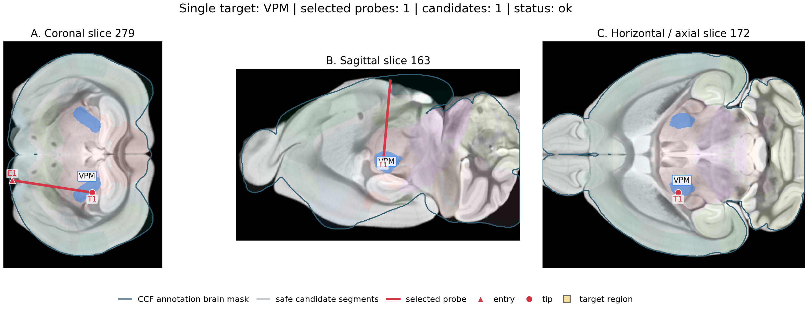
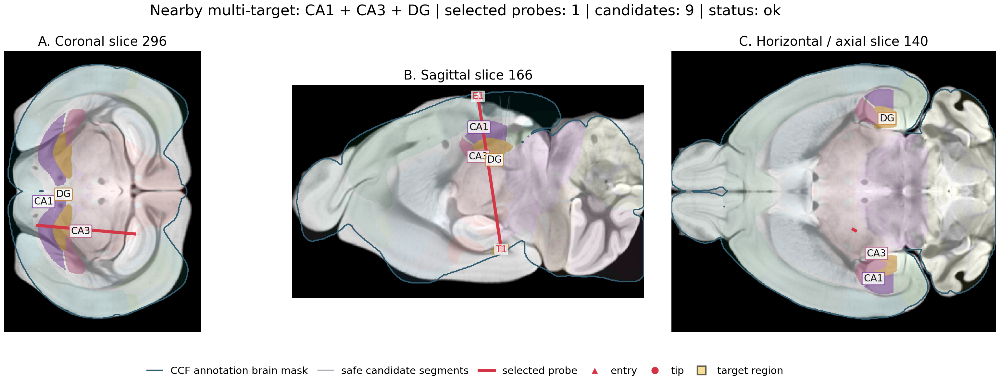
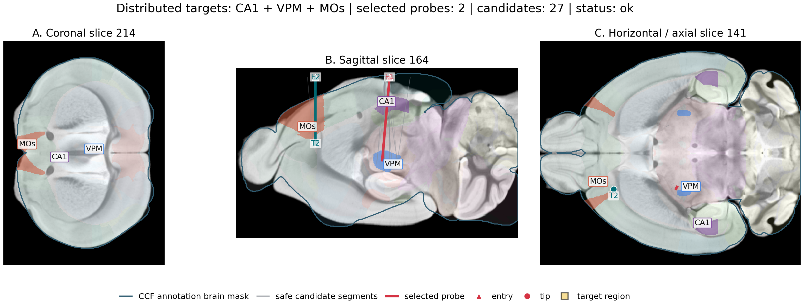
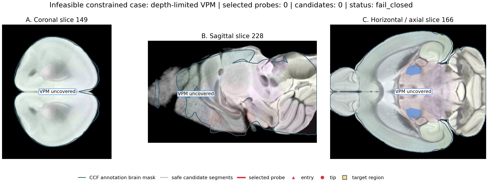

# Real Atlas Case Studies for Automatic Probe Planning - 2026-07-10

This case-study experiment renders real CCF/MRI atlas planning examples. Each figure overlays the registered MRI grayscale image, Allen annotation regions, highlighted target regions, gray candidate trajectories, selected probe trajectories, entry/tip markers, covered/uncovered target labels, and the automatically selected probe count.

## Summary

- Case-study figures: 4
- Successful planned cases: 3
- Fail-closed or unsupported cases: 1
- Selected probe counts shown: 0, 1, 2
- Full-coverage planned cases: 3/4

## Case Summary

| case | purpose | targets | candidates | selected probes | coverage units | uncovered | risk margin mm | status |
|---|---|---|---:|---:|---:|---|---:|---|
| case_01_single_vpm | System outputs one selected probe for a localized thalamic target. | VPM | 1 | 1 | 1/1 | none | NA | ok |
| case_02_merged_hippocampal | System uses one probe to cover adjacent hippocampal targets. | CA1, CA3, DG | 9 | 1 | 3/3 | none | NA | ok |
| case_03_distributed_multitarget | System automatically increases probe count for spatially separated targets. | CA1, VPM, MOs | 27 | 2 | 3/3 | none | NA | ok |
| case_04_depth_limited_uncovered | System reports uncovered target instead of emitting a false trajectory. | VPM | 0 | 0 | 0/1 | VPM | NA | fail_closed |

## Figures

### Single target: VPM

- Requested targets: VPM
- Candidate trajectories: 1
- Selected probe count: 1
- Covered tokens: VPM
- Uncovered targets: none
- Status: ok

### Nearby multi-target: CA1 + CA3 + DG

- Requested targets: CA1, CA3, DG
- Candidate trajectories: 9
- Selected probe count: 1
- Covered tokens: CA1, CA3, DG
- Uncovered targets: none
- Status: ok

### Distributed targets: CA1 + VPM + MOs

- Requested targets: CA1, VPM, MOs
- Candidate trajectories: 27
- Selected probe count: 2
- Covered tokens: CA1, MOs, VPM
- Uncovered targets: none
- Status: ok

### Infeasible constrained case: depth-limited VPM

- Requested targets: VPM
- Candidate trajectories: 0
- Selected probe count: 0
- Covered tokens: none
- Uncovered targets: VPM
- Status: fail_closed

## Interpretation

The case studies provide a visual check that ProbePlanner is not merely reporting aggregate feasibility. The same backend candidate generation and automatic selection path produces compact probe sets for localized and nearby targets, increases probe count for distributed targets, and reports uncovered targets when the constraints make a target unreachable.

## Data Inputs

- Planner profile root: `${PROBEPLANNER_PROFILE_ROOT}`
- MRI-in-CCF volume: `${PROBEPLANNER_REGISTRATION_ROOT}\ants_native_safe_062_cached_syn_grad070_long_s090_axis120_010mm\registration\ambmc_in_ccf.nii.gz`
- Allen annotation volume: `${PROBEPLANNER_PROFILE_ROOT}\annotation.npy`
- Structure color source: `${LOCAL_DATA_ROOT}/structures.json`
